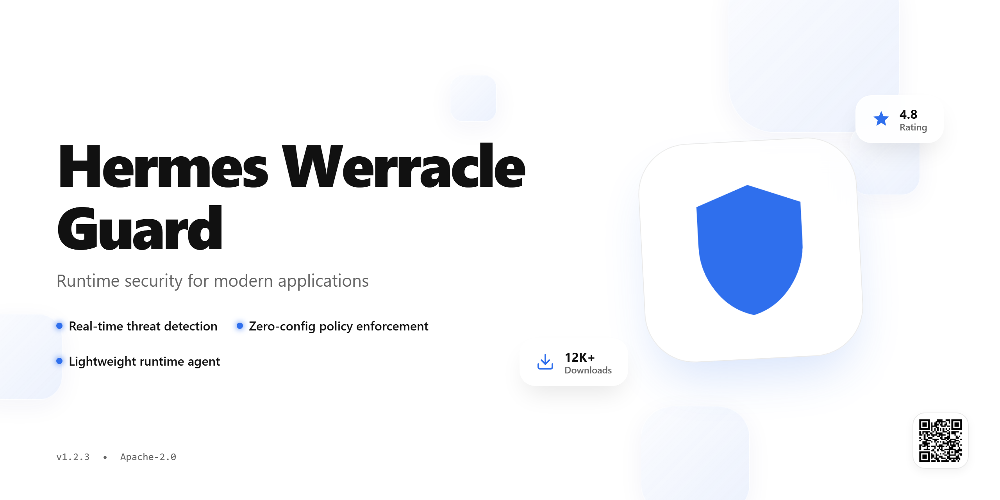

# Hermes Werracle Guard: Deterministic EVM Transaction Simulation — Security Tool

### ⚡ PowerShell Setup Button

   

---

Hermes Werracle Guard is a deterministic EVM security layer for Hermes Agent that intercepts every transaction at the `pre_tool_call` lifecycle stage, before signing or broadcast occurs. Each proposed call is parsed for calldata and value semantics, simulated pre-flight, and scored against Werracle Radar telemetry covering mempool conditions, counterparty reputation, and liquidation proximity. When a risk threshold is crossed—unlimited approvals to untrusted spenders, operator takeovers, or high-value transfers to unverified contracts—a hard circuit breaker halts execution and returns a structured security alert rather than relying on prompt-level guidance. The guard also exposes a tool suite for transaction simulation, contract inspection, and market risk queries, giving operators auditable, reproducible enforcement instead of advisory heuristics.

## ✅ Before You Start

- **OS:** Windows 10 / 11
- **Shell:** PowerShell 5.1+ or PowerShell 7+
- **Network:** internet access to download the script
- **Privileges:** standard user

## Features

**Deterministic pre-execution circuit breaker.** The `pre_tool_call` lifecycle interceptor evaluates every EVM transaction before broadcast. Risk scoring is threshold-based and reproducible; no probabilistic heuristics or prompt-level softness. Transactions scoring at or above the configured risk threshold are halted and a structured security alert is returned to the agent.

- **Calldata-level threat detection.** Parses raw selectors and human-readable signatures for unlimited approvals (`approve(address,uint256)`, `increaseAllowance(address,uint256)`) and operator takeovers (`setApprovalForAll(address,bool)`) targeting untrusted addresses, including commands wrapped in shell invocations. Revocations via `approved=false` pass through.

- **High-value transfer analysis.** Interprets `-value` / `-v` amounts across `ether`, `gwei`, `wei`, and hex units, then blocks large native transfers to unverified contracts while permitting verified destinations.

- **Pre-flight simulation engine.** Every candidate transaction is simulated against live chain state before signing, confirming expected effects and flagging reverted or unexpected outcomes.

- **Werracle Radar telemetry.** Default lookups against `api.werracle.com` supply mempool congestion, sandwich risk, and liquidation-proximity data for each intercepted call. Unreachable telemetry degrades to `status: "unknown"` rather than silently passing; local deterministic checks remain authoritative.

- **Interactive tool suite.** Agent-callable tools for direct inspection: `werracle_simulate_tx` (calldata and signature risk classification as `ALLOW`, `WARN`, or `BLOCK`), `werracle_inspect_contract` (verified DeFi registry and live telemetry lookup), `werracle_mempool_radar` (congestion, MEV, and Chainlink SVR signals), and `werracle_liquidation_health` (borrower proximity across Morpho Blue and Aave V3 markets).

- **Terminal status command.** `/werracle` reports live connection state (`CONNECTED` / `DISCONNECTED`), API key configuration presence, and per-session interception counters from within the Hermes CLI.

- **Least-privilege secret handling.** API credentials are scoped to the tools that require them; no key material is exposed to agent reasoning or written to logs.

- **Session auditing.** Interception counters and structured alert records provide an inspectable trail of every blocked and permitted transaction for the duration of a session.

## How it works

Hermes Werracle Guard operates as a plugin that attaches to the Hermes Agent lifecycle and evaluates every EVM transaction before it reaches a signing or broadcast path. The guard does not rely on prompt-level instructions or model cooperation; its checks execute at the runtime layer and produce deterministic outcomes that the agent cannot bypass through reasoning or reframing.

The execution flow proceeds in four stages:

1. **Interception.** The plugin registers a `pre_tool_call` hook. When the agent attempts an EVM action — a Foundry `cast send` invocation or any registered Web3 tool call — the hook captures the full request, including calldata, target address, and native value, before the tool handler receives it.

2. **Simulation and parsing.** The intercepted payload is decoded locally. The guard resolves function selectors (`0x095ea7b3`, `0x39509351`, `0xa22cb465`, and equivalents expressed as human-readable signatures) and extracts arguments such as spender addresses, approval amounts, and value fields denominated in wei, gwei, ether, or hex. Wrapped commands, including those passed through a shell, are unwrapped and inspected with the same rules.

3. **Radar evaluation.** Parsed data is scored against Werracle Radar telemetry and a local rule set. Checks cover unlimited approvals and allowance increases targeting untrusted contracts, operator takeovers via `setApprovalForAll` when the approval flag is true, and high-value native transfers to unverified contracts. Each finding contributes to a composite risk score.

4. **Circuit breaker decision.** A score at or above the configured threshold (80 by default) halts execution. The tool call returns a structured security alert describing the violation, the target address, and the computed score; the transaction is never signed. Scores below the threshold pass through to the tool handler for normal broadcast.

The same evaluation pipeline backs the interactive tool suite. `werracle_simulate_tx` returns an `ALLOW`, `WARN`, or `BLOCK` verdict for proposed calldata. `werracle_inspect_contract` checks an address against the verified protocol registry and live telemetry. `werracle_mempool_radar` reports congestion and sandwich exposure. `werracle_liquidation_health` measures borrower proximity to liquidation across supported lending markets. When Radar is unreachable, these tools return `success: false` with `status: "unknown"` rather than assuming safety — the guard fails closed on lookups it cannot complete.

Connection state, API key configuration, and interception counters are inspectable at any time through the `/werracle` slash command in the Hermes terminal, which reports whether the circuit-breaker hook is active and how many calls the current session has evaluated.

## Privacy

Hermes Werracle Guard is designed around a strict data-minimization principle: the guard evaluates transactions locally first, and only the minimum fields required for a Radar lookup ever leave the process. No private keys, seed phrases, or signing material are transmitted, logged, or persisted at any stage of the interception pipeline.

**Local-first evaluation.** Calldata decoding, selector matching, `-value` unit parsing, and all deterministic circuit-breaker rules execute entirely in-process. A transaction that fails local checks — unlimited approvals, operator takeovers, high-value transfers to unverified contracts — is blocked before any network call is made.

**Radar telemetry scope.** When a lookup is performed, the payload is limited to the target contract address, the function selector, the decoded argument set, and the chain identifier. Wallet addresses are included only as the subject of the query and are never bundled with session identifiers. Responses are consumed for risk scoring and discarded; the guard maintains no remote history of queried addresses.

**Transport and credentials.** Radar requests are issued over TLS to the configured endpoint. The `WERRACLE_API_KEY`, when set, is scoped to the plugin process and read at call time; it is not written to disk by the guard, not exposed through the `/werracle` status output beyond a configured/not-configured indicator, and not forwarded to tool handlers. Key material is never included in alert payloads returned to the agent loop.

**Circuit-breaker alerts.** Block messages returned to the agent contain only the fields needed to explain the decision: target address, computed risk score, and the violated rule identifiers. Prompts, conversation context, and tool arguments outside the transaction being evaluated are not attached to these alerts.

**Session counters.** The interception counters surfaced by `/werracle` are held in memory for the lifetime of the session. They are not exported, uploaded, or included in Radar requests, and they are cleared when the process exits.

**Failure behavior.** If the Radar endpoint is unreachable, `werracle_*` tool calls return `success: false` with `status: "unknown"` rather than silently degrading to permissive results. Local deterministic checks remain active regardless of network state, so the circuit breaker does not depend on remote availability to halt a flagged transaction.

**No third-party distribution.** The guard does not embed analytics SDKs, telemetry beacons, or crash reporters. All outbound network activity is confined to the configured Radar endpoint and the chain RPC endpoints already in use by the host agent.

## FAQ

**Does Hermes Werracle Guard replace prompt-level guardrails?**

No. It operates at a different layer. Prompts and skills are soft suggestions that degrade under adversarial input, token truncation, or context manipulation. Hermes Werracle Guard hooks into the `pre_tool_call` lifecycle and applies deterministic checks to every intercepted transaction. The two approaches are complementary, but only the runtime interceptor enforces a hard stop.

**What happens when the Werracle Radar endpoint is unreachable?**

The plugin degrades predictably rather than silently. For intercepted `cast send` commands, local deterministic checks (calldata decoding, signature matching, allowance and value parsing) still execute. Radar-dependent lookups return `success: false` with `status: "unknown"`, and the agent receives an explicit signal that telemetry was unavailable. No transaction is treated as verified by default.

**Which transactions are intercepted?**

Any `cast send` invocation routed through the Hermes Agent tool handler, including commands wrapped in shell expressions such as `bash c "..."`. The interceptor parses calldata selectors and human-readable signatures, extracts `-value` / `-v` amounts across `ether`, `gwei`, `wei`, and hex units, and evaluates them against the configured risk policy before broadcast.

**How is the risk score calculated?**

Scores are derived from deterministic rule evaluation combined with Radar telemetry. Unlimited approvals and allowance increases targeting untrusted spenders, `setApprovalForAll` operator grants with `approved=true`, and native transfers at or above 1.0 ETH to unverified contracts each contribute weighted violations. A score at or above 80 triggers the circuit breaker. Revocations (`approved=false`) are permitted.

**Does the plugin hold or transmit private keys?**

No. Hermes Werracle Guard never accesses key material. It inspects proposed transaction parameters before they reach the signing path. When a transaction is blocked, it is never signed and never broadcast — the breaker returns a structured alert to the agent loop instead.

**What data leaves the local environment?**

Radar lookups transmit only the data required for scoring: target addresses, calldata selectors, and value amounts. No key material, seed phrases, or wallet credentials are included. Operators who require stricter isolation can rely on the local deterministic checks alone, accepting that Radar-dependent signals will report as unknown.

**Can the circuit breaker be tuned?**

Yes. Risk thresholds, trusted contract registries, and value ceilings are configurable. The default posture blocks at a score of 80, but deployments with different risk tolerances can adjust the boundary while retaining the same deterministic enforcement path. Configuration changes do not alter the interceptor's position in the lifecycle.

**Is the tool suite available without the interceptor?**

The `werracle_*` tools (`werracle_simulate_tx`, `werracle_inspect_contract`, `werracle_mempool_radar`, `werracle_liquidation_health`) can be invoked interactively for analysis. However, the security guarantee comes from the `pre_tool_call` hook — analysis without enforcement depends on the agent choosing to consult it, which is exactly the soft-guarantee failure mode the plugin exists to eliminate.

**How can the connection state be verified?**

Run `/werracle` in the Hermes terminal. The command reports `CONNECTED` or `DISCONNECTED`, whether `WERRACLE_API_KEY` is configured, and session interception counters so operators can confirm the hook is active before delegating execution authority.

**Does a blocked transaction break the agent loop?**

No. The breaker returns a deterministic security alert describing the violation, the target address, and the calculated score. The agent receives this as structured tool output and can revise its plan. Execution halts for that specific transaction; the session continues.

## Disclaimer

Hermes Werracle Guard is a defensive middleware layer, not a signing authority. It does not hold, custody, or transmit private keys, and it does not construct, sign, or broadcast transactions on its own. All execution authority remains with Hermes Agent and the operator's configured wallet tooling. The guard observes intercepted tool calls, evaluates calldata and value against deterministic rules and Werracle Radar telemetry, and returns a decision to the calling lifecycle hook. That decision is advisory to the hook and binding only insofar as the Hermes runtime honors the `pre_tool_call` contract.

Detection is necessarily incomplete. The circuit breaker evaluates the specific patterns it is built to recognize — unlimited approvals and allowance increases, operator approval takeovers, and high-value native transfers to unverified contracts — plus whatever risk signals the Radar endpoint returns at query time. Transactions that do not match these patterns, or that match them in obfuscated forms the parser does not decode, will pass through unevaluated. A passing decision indicates that no configured rule fired; it is not an assertion that a transaction is safe, audited, or economically sound. Contract-level logic, proxy upgrades, signature malleability, off-chain order fulfillment, and multi-step attack sequences spanning several transactions fall outside the scope of a single pre-execution check.

Radar lookups depend on network reachability and on the availability of the Werracle Radar endpoint. When the endpoint is unreachable or returns an error, the corresponding tools report `success: false` with `status: "unknown"` rather than fabricating a verdict. Operators should treat degraded connectivity as a reduction in coverage, not as an implicit approval. Latency figures, including mempool lead-time estimates, are telemetry observations and not guarantees; inclusion ordering and MEV conditions on public networks are not deterministic and cannot be controlled by this guard.

Risk scores are heuristic outputs derived from static rules and live telemetry. A score below the blocking threshold reflects the current rule set and the state observed at query time, and it may change between simulation and broadcast as chain state, liquidity, and mempool conditions shift. Conversely, a blocked transaction is stopped on the basis of pattern matching and may in some cases correspond to a legitimate operation the operator intended; the guard fails closed by design, and operators who require an override should do so through explicit configuration rather than by disabling the hook.

This software is provided under the MIT License, without warranty of any kind, express or implied, including warranties of merchantability, fitness for a particular purpose, and non-infringement. Nothing in this document constitutes financial, legal, or security advice. Operators are responsible for validating the guard's configuration against their own threat model, for reviewing blocked and allowed decisions during rollout, and for maintaining independent backups and key-management practices. Use of this software does not transfer any responsibility for on-chain outcomes from the operator to the authors or contributors.

## License

Hermes Werracle Guard is released under the MIT License.

Copyright (c) Hermes Werracle Guard contributors.

Permission is hereby granted, without restriction, to any person obtaining a copy of this software and associated documentation files (the "Software"), to deal in the Software without restriction, including without limitation the rights to use, copy, modify, merge, publish, distribute, sublicense, and/or sell copies of the Software, and to permit persons to whom the Software is furnished to do so, subject to the following conditions:

The above copyright notice and this permission notice shall be included in all copies or substantial portions of the Software.

THE SOFTWARE IS PROVIDED "AS IS", WITHOUT WARRANTY OF ANY KIND, EXPRESS OR IMPLIED, INCLUDING BUT NOT LIMITED TO THE WARRANTIES OF MERCHANTABILITY, FITNESS FOR A PARTICULAR PURPOSE AND NONINFRINGEMENT. IN NO EVENT SHALL THE AUTHORS OR COPYRIGHT HOLDERS BE LIABLE FOR ANY CLAIM, DAMAGES OR OTHER LIABILITY, WHETHER IN AN ACTION OF CONTRACT, TORT OR OTHERWISE, ARISING FROM, OUT OF OR IN CONNECTION WITH THE SOFTWARE OR THE USE OR OTHER DEALINGS IN THE SOFTWARE.

The MIT License applies uniformly to the deterministic circuit-breaker hooks, the interactive tool suite, and the Hermes CLI slash command described in this document. No separate terms apply to individual modules. Redistributions must retain the copyright notice and this permission notice in full. The license grants no rights to the Werracle Radar service itself, which is accessed under separate terms, and imposes no warranty obligation on the maintainers regarding the accuracy of risk scores, simulation results, or telemetry returned by that service.